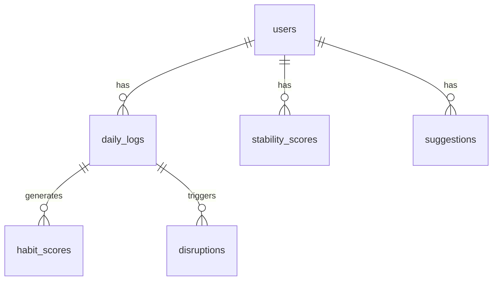

<div align="center">

# 📊 Healthy Routine Stability Score

**Quantify your habits, measure consistency, and unlock actionable insights.**

[](https://www.python.org/downloads/)
[](https://opensource.org/licenses/MIT)
[](https://github.com/psf/black)

*A Python CLI application that tracks daily habits, quantifies behavioural consistency using statistical analysis, and surfaces actionable insights through rich terminal reports.*

[Features](#-features) • [Installation](#-installation) • [Usage](#-usage) • [How it Works](#-how-the-score-is-calculated) • [Database](#-architecture--database-schema)

</div>

---

## 💡 What is a Routine Stability Score?

A **Routine Stability Score** measures not just *whether* you performed a healthy habit, but **how consistently** you performed it over time. Consistency is the key driver of long-term health outcomes — sleeping 8 hours every night is more restorative than averaging 8 hours with wild swings between 5 and 11. 

This system calculates a **Coefficient of Variation** for each habit across a rolling 7-day window, converts it into a `0–100` stability percentage, and blends five habit scores into a single weighted composite score. Disruptions are detected when a day's value deviates more than a configurable threshold (default: `2×` standard deviation) from the recent baseline, and are automatically classified by severity.

---

## ✨ Features

- 📝 **Daily Habit Logging** — Guided terminal wizard for sleep, meals, activity, hydration, screen time, and wellbeing scores.
- ⚙️ **Stability Scoring Engine** — Rolling 7-day statistical analysis (mean, std dev, coefficient of variation) per habit.
- ⚖️ **Weighted Composite Scoring** — Configurable per-habit weights summing to a single 0–100 daily score.
- 🚨 **Disruption Detection** — Automatic detection and severity classification (low / medium / high) of off-baseline days.
- 🔍 **Pattern Analysis** — Identifies stable vs. unstable habits and calculates mood/energy/productivity correlations.
- 💡 **Rule-Based Suggestions** — Generates actionable, habit-specific recommendations for the current week.
- 💻 **Rich Terminal Reports** — Colour-coded daily and weekly reports rendered with the `rich` library.
- 📈 **Matplotlib Charts** — Daily trend line, per-habit bar chart, and stability vs. mood scatter plot.
- 🗄️ **SQLite Database** — Fully normalised 6-table schema with foreign key constraints and cascades.

---

## 🏗️ Architecture & Database Schema



| Table | Key Columns | Relationships |
|---|---|---|
| **users** | `user_id` PK, `name`, `email`, `timezone`, `target_sleep_hr`, `target_water_ml`, `target_steps` | Parent of all other tables |
| **daily_logs** | `log_id` PK, `user_id` FK, `log_date`, `sleep_duration_hr`, `meal_times`, `steps`, `water_ml`, `screen_min`, `mood_score`, `energy_score`, `productivity_score` | UNIQUE(`user_id`, `log_date`) |
| **habit_scores** | `score_id` PK, `log_id` FK, `user_id` FK, `habit_type`, `raw_value`, `seven_day_mean`, `seven_day_std`, `deviation`, `stability_pct`, `is_disrupted` | One row per habit per log |
| **stability_scores** | `id` PK, `user_id` FK, `score_date`, `period_type`, `overall_score`, per-habit scores | Stores computed aggregates |
| **disruptions** | `id` PK, `log_id` FK, `user_id` FK, `habit_type`, `severity`, `description` | Written when disruption detected |
| **suggestions** | `id` PK, `user_id` FK, `week_of`, `habit_type`, `suggestion_text`, `priority`, `is_shown` | Weekly, rule-based |

---

## 🧮 How the Score is Calculated

### 1️⃣ Per-Habit Stability (rolling 7-day window)
For each of the five tracked habits, the engine collects the last 7 days of values plus today's value (8 data points maximum):

```python
mean    = average(values)
std_dev = population_standard_deviation(values)
CV      = (std_dev / mean) * 100          # Coefficient of Variation (%)
stability_pct = max(0, 100 - CV)          # Higher CV → lower stability
```
*A habit with zero variance scores 100. A habit whose daily value differs by its own mean each day scores near 0.*

### 2️⃣ Weighted Composite Score
The five habit stability percentages are blended using configurable weights:

```python
overall_score = (sleep_stability    * 0.30) + \
                (meal_timing_stab.  * 0.20) + \
                (activity_stability * 0.20) + \
                (hydration_stab.    * 0.15) + \
                (screen_time_stab.  * 0.15)
```
> **Note:** Sleep carries the highest weight (30%) because circadian rhythm is the foundation of all other habits.

### 3️⃣ Disruption Detection
A disruption is flagged when today's deviation from the 7-day mean exceeds the threshold:
`|today - mean| > DISRUPTION_THRESHOLD × std_dev` *(Default: 2.0)*

| Multiple of std_dev | Severity |
| :---: | :--- |
| `2×` – `3×` | 🟡 Low |
| `3×` – `4×` | 🟠 Medium |
| `4×+` | 🔴 High |

### 📊 Score Interpretation

| Score Range | Status | Meaning |
| :---: | :---: | :--- |
| **75 – 100** | 🟢 **Stable** | Excellent routine consistency |
| **50 – 74**  | 🟡 **Moderate** | Some drift, worth monitoring |
| **0 – 49**   | 🔴 **Unstable** | Significant disruptions detected |

---

## 🚀 Installation

**Requirements:** Python 3.9+

```bash
# 1. Clone or download the project
git clone https://github.com/shazimjaved/Health-stability-score-app.git
cd healthy_routine_score

# 2. Create a virtual environment
python -m venv venv

# Windows
venv\Scripts\activate
# macOS / Linux
source venv/bin/activate

# 3. Install dependencies
pip install -r requirements.txt
```

---

## 💻 Usage

Start the application by running:
```bash
python main.py
```

---

## 📂 Project Structure

```text
healthy_routine_score/
├── db/                         # Database layer
│   ├── schema.sql              # Raw SQLite DDL (Source of Truth)
│   ├── models.py               # SQLAlchemy ORM models + init_db()
│   └── seed_data.py            # Inserts realistic demo data
├── engine/                     # Business logic layer
│   ├── data_loader.py          # Terminal wizard + InputValidator
│   ├── score_engine.py         # 7-day stats, daily/weekly scoring
│   └── pattern_detector.py     # Disruptions, correlations, suggestions
├── reports/                    # Presentation layer
│   ├── daily_report.py         # Rich terminal daily report
│   └── weekly_report.py        # Weekly summary & charts
├── output/                     # Generated files (charts)
├── config.py                   # Global configuration
├── main.py                     # CLI entry point
└── requirements.txt
```

---

## 🛠️ Configuration

Edit `config.py` to customise the system parameters:

```python
DATABASE_URL = "sqlite:///healthy_routine.db"

HABITS = ["sleep", "meal_timing", "activity", "hydration", "screen_time"]

WEIGHTS = {
    "sleep":       0.30,   # Circadian rhythm — most important
    "meal_timing": 0.20,   # Metabolic regulation
    "activity":    0.20,   # Physical consistency
    "hydration":   0.15,   # Often overlooked
    "screen_time": 0.15,   # Sleep and focus impact
}

DISRUPTION_THRESHOLD = 2.0   # Std deviations before flagging a disruption
```
